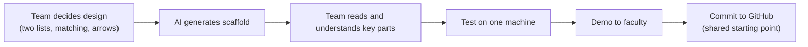

# AI-Assisted Development & Vibe Coding (explained simply)

This session was pure project work, and the list matching project's first version was scaffolded with Claude. These notes capture the workflow and what stays the developer's responsibility.

## What vibe coding means

A workflow where the main role shifts from writing code line by line to **guiding an AI assistant** to generate, refine, and debug an application conversationally. Industry data cited in class reading: **72% of developers use AI coding tools daily and 41% of global code is AI-generated** (daily.dev, 2026).

## The workflow used for the list matching project

## What stays human

- **Design decisions:** what to build and why. The AI implements, it does not decide the scope.
- **Review:** read generated code before running it. The course permits AI help *only if you can explain what you built*.
- **Validation:** check the output against the requirements, not just "does it run".

## Practical habits

- Give clear instructions and context; let the AI ask for clarification rather than guess (reduces hallucinated details).
- Treat the assistant as a pair programmer, not an autonomous agent.
- Get a demo in front of the reviewer early: cheap to correct direction now, expensive after weeks of building.
- Commit the approved base immediately so the team branches from one clean version (see [group-project-git-governance](group-project-git-governance.md)).

## Simple analogy
An architect draws the plans and an experienced builder constructs them. The architect still has to inspect the building and be able to explain every wall.

## Key takeaway
> AI speeds up getting to a testable version, but it shifts the work to design intent and critical review. Code you cannot explain is not ready to submit.
