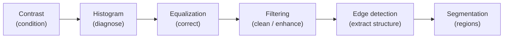

# Edge Detection, Canny & Segmentation (explained simply)

**Edges** are places where pixel intensity changes sharply: object boundaries and transitions between regions. Edge detection finds them, producing an **edge map** that is the starting point for **segmentation** (dividing an image into meaningful regions).

## Gradient-based detectors (Sobel, Prewitt)

Use derivative kernels from [convolution-and-spatial-filtering](convolution-and-spatial-filtering.md) to measure how fast intensity changes in the horizontal (Gx) and vertical (Gy) directions:

```
magnitude = sqrt(Gx^2 + Gy^2)
direction = atan2(Gy, Gx)
```

A large magnitude means a strong edge. Sobel adds smoothing weights; Prewitt uses plain weights. (The same `atan2` shows up in [set-intersection-and-arrow-drawing](set-intersection-and-arrow-drawing.md).) A Laplacian uses the second derivative and finds edges at zero-crossings, but is more sensitive to noise.

## The Canny detector: a four-stage pipeline

| Stage | Why it exists |
|---|---|
| 1. **Gaussian blur** | Suppress noise so it isn't mistaken for edges |
| 2. **Gradient magnitude and direction** | Find where intensity changes fast and which way |
| 3. **Non-maximum suppression** | Thin thick edge responses to single-pixel width, keeping only local maxima along the gradient direction |
| 4. **Hysteresis thresholding** | Two thresholds: keep strong edges, and keep weak edges only if connected to a strong one |

Pipeline design matters: each stage has a reason, and skipping one degrades the output predictably (e.g. no blur means noisy, broken edges; no hysteresis means either missing edges or spurious ones).

## The whole pipeline



See [image-contrast-histograms-and-equalization](image-contrast-histograms-and-equalization.md) for the first stages.

## Real-world uses
- **Autonomous vehicles:** lane markings, pedestrians, other vehicles
- **Medical imaging:** tumour boundaries in CT/MRI scans, where tissue boundaries are critical
- **Document scanners:** Otsu thresholding plus edge/outline detection for page detection

## Simple analogy
Tracing the outline of a drawing: first wipe off smudges (blur), find where the colour changes (gradient), redraw each line as one thin stroke (non-max suppression), and keep a faint line only if it connects to a bold one (hysteresis).

## Key takeaway
> Edges are sharp intensity changes. Sobel/Prewitt measure the gradient; Canny turns that into clean, thin, connected edges through blur, gradient, non-maximum suppression, and hysteresis, and the edge map feeds segmentation.
