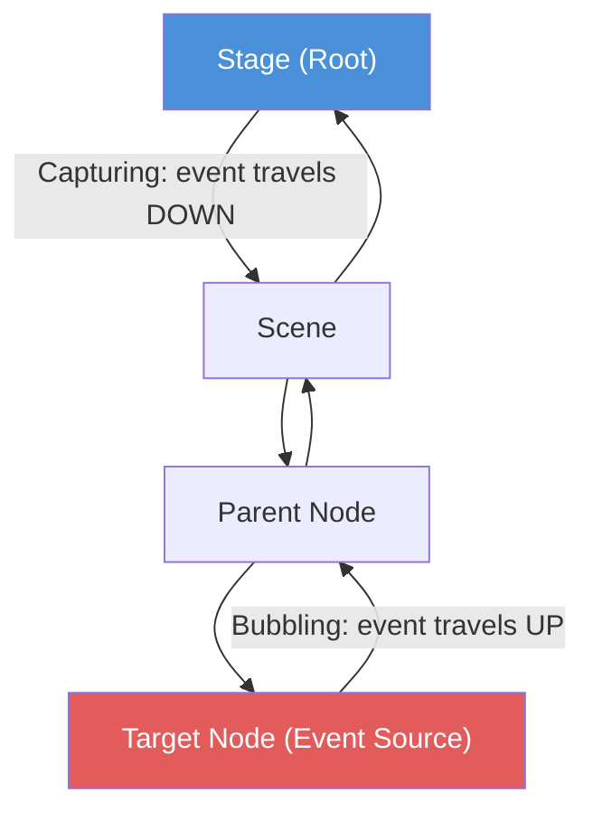

# JavaFX Event Propagation: Capturing & Bubbling (explained simply)

Builds on the mouse listener from Lecture 8 (drawing arrows between circles). There, "something listens for a mouse click and responds" was enough. This is the formal structure behind it.

## Events travel through the scene graph

Every interaction — a click, key press, scroll — generates an **event**. In JavaFX it doesn't jump straight to its target. It travels through the scene graph in **two phases**:

1. **Capturing (down):** from the root (Stage → Scene → parent nodes) *down* to the target node where the interaction happened.
2. **Bubbling (up):** from the target node back *up* to the root.

Blue = root where the event enters. Red = target where the interaction actually happened.

## Filter vs handler

- **Event filter** — registered on a node, runs during the **downward (capturing)** phase. It can intercept an event *before* it reaches the target.
- **Event handler** — runs during the **upward (bubbling)** phase, responding after the target has seen the event.

**Consuming an event** (`event.consume()`) stops it from continuing along the rest of the chain. This is the common source of "my event never fired" bugs: a filter or handler higher/lower on the path consumed it.

## Why this matters

Once a GUI is nested — containers inside containers, overlapping components — wiring each interaction manually becomes unmanageable. The two-phase model lets a parent react to events from any child without each child knowing about it. Getting it wrong means events fire in the wrong order or not at all.

## Simple analogy
A message passed through a company: it goes *down* the chain of command to the right employee (capturing — managers can intercept it on the way), the employee deals with it, and the report goes back *up* the chain (bubbling — each manager can respond on the way back). Anyone who "consumes" the message ends its journey.

## Key takeaway
> JavaFX events travel root → target (capturing, filters intercept) then target → root (bubbling, handlers respond). Consuming an event stops it. Choosing filter vs handler depends on which phase you need to act in.
