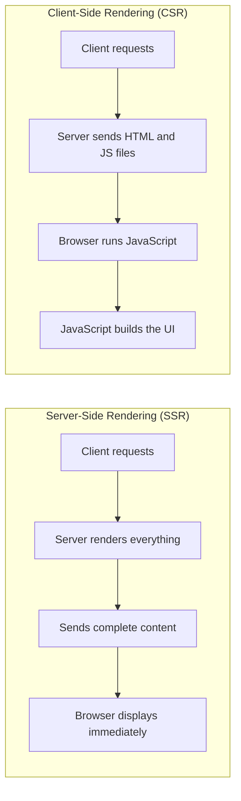

# Server-Side vs Client-Side Rendering (explained simply)

The core question: **where does the rendering work happen?**

- **SSR (Server-Side Rendering):** the server renders everything and sends complete, ready-to-display content.
- **CSR (Client-Side Rendering):** the server sends raw files (HTML + JavaScript) and the client's machine builds the UI locally.

## Trade-offs

| Factor | SSR | CSR |
|---|---|---|
| First-load speed | Faster: complete HTML arrives immediately | Slower: must download and run JS first |
| SEO | Better: content is pre-rendered and crawlable | Weaker: crawlers may not execute JS |
| Server cost | Higher: server renders every request | Lower: server only sends static files |
| Interactivity | Lower: page reloads for updates | Higher: JS updates the UI without reloading |
| Later navigation | Slower: new server render per page | Faster: JS handles transitions locally |
| Best for | Content sites, news, landing pages | Web apps, dashboards, interactive tools |

If the server renders, the client gets a finished product but the server carries the load. If the client renders, the server's job is simple but every client pays the cost. The table follows from that one idea.

## Connections

- **Headless systems** ([ascii-vs-graphics-and-headless-systems](ascii-vs-graphics-and-headless-systems.md)): a headless server with no display is exactly what does SSR — same idea from the hardware side vs the software side.
- **SVG** ([svg-and-xml-vector-graphics](svg-and-xml-vector-graphics.md)): the server sends the XML, the client's browser renders it.
- **CSE330 Computer Networks:** this is a network architecture decision about where computation lives.

## Key takeaway
> SSR renders on the server (fast first load, better SEO); CSR renders on the client (fast later interactions, cheaper server). Pick based on whether the product is content-heavy or interaction-heavy.
